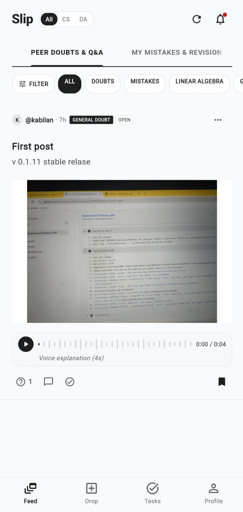
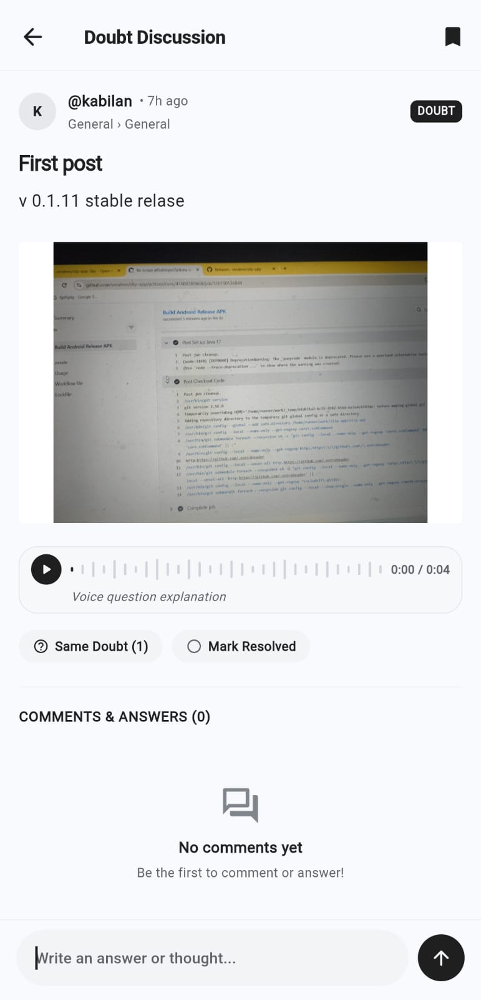
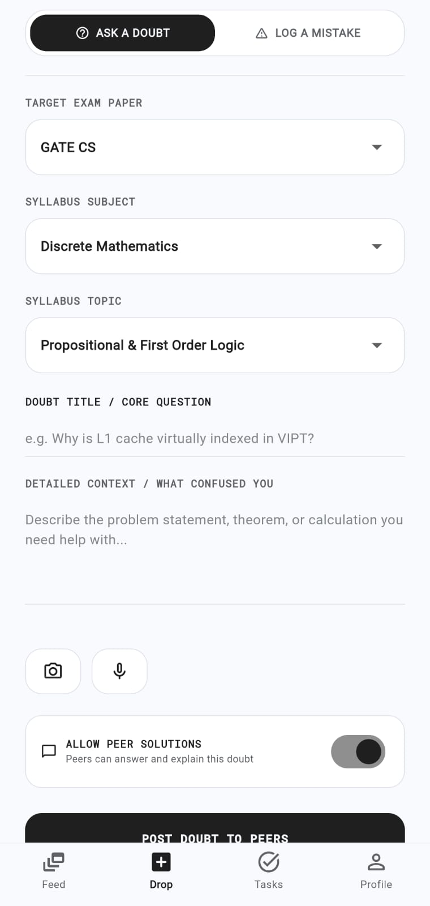
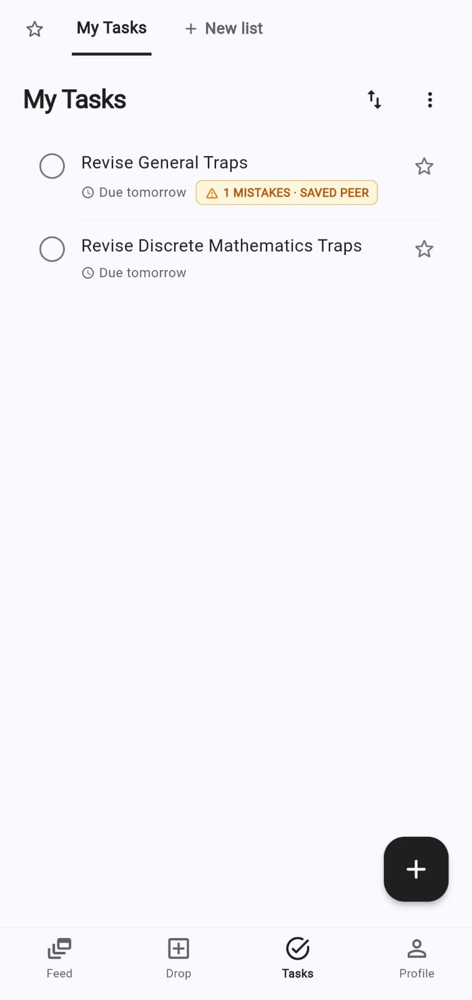
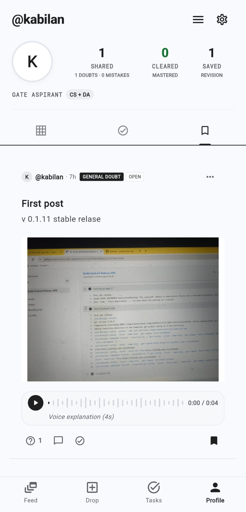
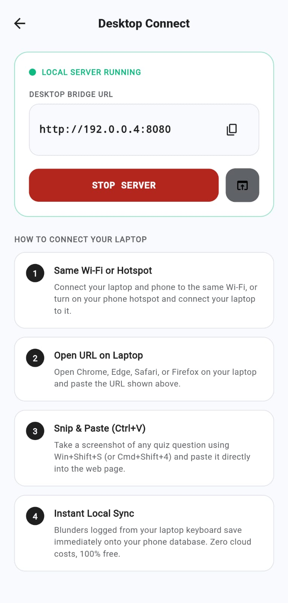
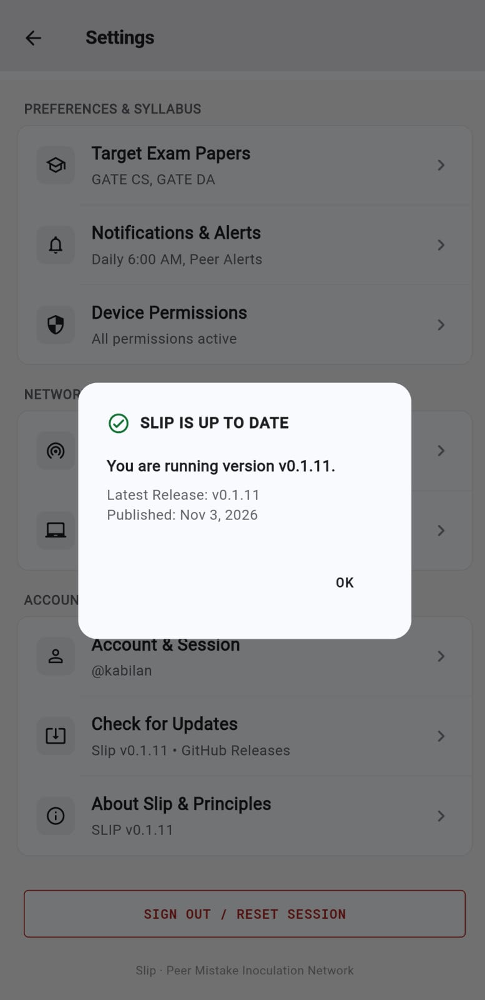
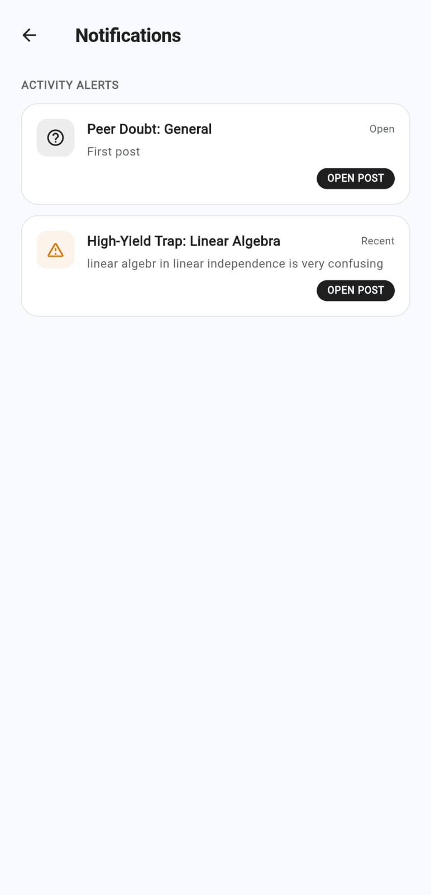
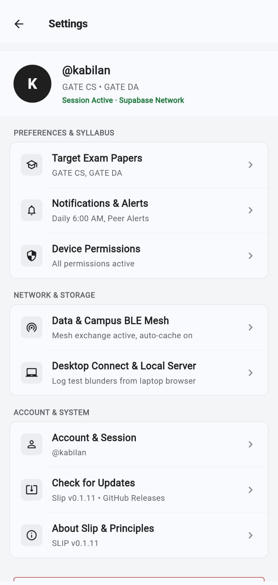

# Slip — Peer Mistake Inoculation Platform

> **Ask doubts. Learn from mistakes. Master together.**

**Slip** is an open-source, peer-to-peer exam blunder inoculation and conceptual doubts platform designed specifically for competitive STEM and GATE aspirants (**CS**, **DA**, **EC**, **EE**, **ME**, and General Doubts). Instead of scrolling through generic social feeds or passive flashcards, Slip operates as a decentralized, mistake-first learning network where students record the exact cognitive traps they fell into and the single corrective principle (*The Fix*) needed to prevent repeating them.

---

## Visual Tour & Key Capabilities

<div align="center">
  <table>
    <tr>
      <td width="33%" align="center">
        <strong>The Stream Feed</strong><br>
        
      </td>
      <td width="33%" align="center">
        <strong>Threaded Discussions</strong><br>
        
      </td>
      <td width="33%" align="center">
        <strong>Drop Slip Composer</strong><br>
        
      </td>
    </tr>
    <tr>
      <td align="center">
        <em>Clean Swiss non-boxy learning ledger with interactive reactions</em>
      </td>
      <td align="center">
        <em>Nested replies, accepted answers, and audio autopsy playback</em>
      </td>
      <td align="center">
        <em>Camera capture for scratchpads and on-device voice autopsy</em>
      </td>
    </tr>
    <tr>
      <td width="33%" align="center">
        <strong>Tasks & Revision</strong><br>
        
      </td>
      <td width="33%" align="center">
        <strong>Student Profile</strong><br>
        
      </td>
      <td width="33%" align="center">
        <strong>Desktop Connect Bridge</strong><br>
        
      </td>
    </tr>
    <tr>
      <td align="center">
        <em>Google Tasks canvas scheduler with linked revision traps</em>
      </td>
      <td align="center">
        <em>Shared, cleared, and saved blunders with mastery breakdown</em>
      </td>
      <td align="center">
        <em>Local Wi-Fi server with password gate and Ctrl+V screenshot paste</em>
      </td>
    </tr>
    <tr>
      <td width="33%" align="center">
        <strong>In-App Self-Updater</strong><br>
        
      </td>
      <td width="33%" align="center">
        <strong>Inoculation Reminders</strong><br>
        
      </td>
      <td width="33%" align="center">
        <strong>Syllabus & Preferences</strong><br>
        
      </td>
    </tr>
    <tr>
      <td align="center">
        <em>Direct GitHub Releases updater with zero data loss guarantee</em>
      </td>
      <td align="center">
        <em>Scheduled morning alerts and peer mesh broadcast alerts</em>
      </td>
      <td align="center">
        <em>Target exam selector (GATE CS/DA/EC/EE/ME) and server controls</em>
      </td>
    </tr>
  </table>
</div>

---

## Core Features & Experience

* **The Feed (`feed_screen.dart`):** Continuous, non-boxy learning ledger inspired by Swiss International Style (Massimo Vignelli, Dieter Rams, Teenage Engineering).
  * **Interactive Action Row:** Scale-burst animations on Solved checkmark, micro-pop animations with floating pill feedback (`+1 Same doubt!`) on doubt reactions, live comment count badges, and Instagram-style save/bookmark pop.
  * **General Doubt Taxonomy:** Clean `[GENERAL]` tag for non-syllabus questions alongside canonical IIT GATE subject tags.
* **Deep Post Detail & Discussions (`post_detail_screen.dart`):**
  * Tap any card to view full conceptual explanations, high-resolution scratchpad photo lightbox, streaming voice notes, and nested Reddit-style peer replies.
  * Live reactive action bar with animated Same Doubt, Resolved checkmark, and Save bookmarks.
* **Drop Slip Composer (`drop_slip_screen.dart`):**
  * Native camera capture for handwritten calculations and question diagrams.
  * Native on-device voice note recording with waveform preview and audio timer.
  * Cascading department/subject dropdown with instant General Doubt toggle.
* **Tasks & Revision Ledger (`tasks_screen.dart`):**
  * Google Tasks-inspired scheduler rendered directly on the canvas without boxy card clutter.
  * Multi-list sliding tabs (`Starred`, `My Tasks`, custom lists) with due-date tracking and linked revision traps.
* **Student Profile (`profile_screen.dart`):**
  * Reddit-style text-first feed layout prioritizing formulas, traps, and misconceptions.
  * Unified 3-dot overflow menu for editing and deleting posts.
  * Multi-account data isolation ensuring private notes remain private.
* **Desktop Connect Bridge (`desktop_connect_service.dart`):**
  * Built-in embedded `HttpServer` (port 8080) for LAN/Wi-Fi use.
  * Password-protected access gate with embedded phone account handle.
  * Paste question screenshots directly with `Ctrl + V` and type mathematical equations from your PC keyboard.
* **In-App GitHub Self-Updater (`app_update_service.dart`):**
  * Direct connection to official [GitHub Releases](https://github.com/veraleve/slip-app/releases).
  * Check for updates, read release notes, and install updates in-place (`PACKAGE_REPLACED`) using a permanent cryptographic release keystore.
  * **Zero Data Loss Guarantee:** Preserves all local tasks, blunders, preferences, and session data.
* **Offline-First Resilience:**
  * Persistent authentication and local caching for campus libraries and study halls.
  * Multi-account scoping isolates local notes per user handle.

---

## Project Structure

```
slip-app/
├── .github/
│   └── workflows/
│       ├── ci.yml                 # Automated formatting, lint & test gating for PRs
│       └── release.yml            # Automated APK build & GitHub Releases publisher
├── android/                       # Native Android container (FileProvider, APK installer)
│   └── app/src/main/
│       ├── AndroidManifest.xml    # Permissions: REQUEST_INSTALL_PACKAGES, CAMERA, RECORD_AUDIO
│       └── kotlin/.../
│           └── MainActivity.kt    # MethodChannel for audio streaming, recording, camera, and installer
├── images/                        # Application feature screenshots showcased in README
├── lib/
│   ├── constants/                 # GATE syllabus taxonomy & network configuration
│   ├── models/                    # Typed models (Slip, TaskItem, Profile, Comment)
│   ├── providers/                 # Riverpod & ChangeNotifier state managers
│   ├── screens/
│   │   ├── auth_screen.dart       # Username/password auth, password reset, and BLE mesh entry
│   │   ├── feed_screen.dart       # Main peer mistake & doubt ledger
│   │   ├── drop_slip_screen.dart  # Curved blunder & voice note composer
│   │   ├── tasks_screen.dart      # Canvas-style task scheduler with revision traps
│   │   ├── profile_screen.dart    # Reddit-style text-first profile & blunder archive
│   │   ├── post_detail_screen.dart# Interactive blunder discussions & comment replies
│   │   ├── notifications_screen.dart# Mistake inoculation reminders & alert tray
│   │   ├── settings_screen.dart   # Preferences, syllabus selection & GitHub self-updater
│   │   └── splash_principle_screen.dart # Core inoculation principles intro
│   ├── services/
│   │   ├── app_update_service.dart# GitHub Releases OTA updater & changelog parser
│   │   ├── native_device_service.dart # Platform channel bridge (Audio, Camera, Package Installer)
│   │   ├── supabase_service.dart  # Supabase client, storage uploads, scoped local cache
│   │   └── desktop_bridge/
│   │       └── desktop_connect_service.dart # Password-gated local Wi-Fi HTTP server (port 8080)
│   ├── theme/                     # Swiss typography & monochrome palette
│   ├── widgets/                   # Non-boxy slip cards, audio players, hairline inputs
│   └── main.dart                  # Application entry point & session bootstrap
├── pubspec.yaml
└── README.md
```

---

## Download & Installation

The latest production APK (`slip.apk`) is published with every release on GitHub:

* **Direct Release Downloads:** [GitHub Releases](https://github.com/veraleve/slip-app/releases)
* **In-App Updates:** Open `Settings > Check for Updates` inside Slip to view the latest changelog and update in-place without losing your data.

---

## Contributing

1. Fork the repository and create your feature branch (`git checkout -b feature/blunder-recommendations`).
2. Adhere strictly to the Swiss Minimalist design principles: zero emojis in UI titles/buttons, clean typography, non-boxy curved surfaces.
3. Ensure the project passes all checks:
   ```bash
   flutter analyze
   flutter test
   ```
4. Submit a Pull Request targeting `main`. All PRs undergo automated CI verification.
